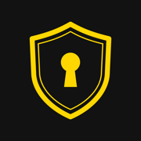

  

<h1 align="center">PassM — Local Hardware-Encrypted Password Vault</h1>

  <strong>100% 離線零知識硬體加密密碼庫 · Zero Servers · Zero Subscriptions · iOS / iPadOS / Android</strong>

  <a href="https://aomeios.github.io/passm-support/">🌐 <strong>Official Website / 官方網站</strong></a> ·
  <a href="https://aomeios.github.io/passm-support/support.html">🛟 <strong>Support &amp; FAQ / 客戶支援中心</strong></a> ·
  <a href="https://aomeios.github.io/passm-support/privacy.html">🔒 <strong>Privacy Policy / 隱私權政策</strong></a> ·
  <a href="https://apps.apple.com/app/id6835392141"> <strong>App Store</strong></a>

---

## 🛟 Customer Support / 客戶支援與聯絡管道（免註冊可直接來信）

- **Official Support & FAQ Web Page / 支援與常見問題專頁**：  
  👉 **[https://aomeios.github.io/passm-support/support.html](https://aomeios.github.io/passm-support/support.html)**
- **Direct Support Email / 官方客服信箱（無須 GitHub 帳號）**：  
  📧 **[coolcrist@gmail.com](mailto:coolcrist@gmail.com)**
- **Public Issue Tracker / 公開問題追蹤與功能建議**：  
  🛠️ **[GitHub Issues](https://github.com/aomeios/passm-support/issues)**

> [!CAUTION]
> **⚠️ 無密回報安全守則 / No-Secret Reporting Rule**  
> PassM 支援團隊在任何情況下**絕不會**向您索取密碼或備份檔。來信或開立 Issue 時，**請絕對不要提供**您的「主密碼（Master Password）」、「備份密碼」、「`.passmbak` 加密備份檔」、「CSV 檔」或任何未遮蔽之密碼螢幕截圖。  
> *NEVER share your Master Password, Backup Password, `.passmbak` archive, CSV file, or unmasked screenshots when contacting support.*

---

## 🛡️ Architecture Highlights / 安全架構重點

| Layer | Specification |
| :--- | :--- |
| **Zero Cloud / Network** | 100% local processing; zero backend servers, zero analytics/ad SDKs; `INTERNET` permission stripped on Android |
| **Key Derivation** | `PBKDF2-HMAC-SHA256` (600,000 iterations) + `HKDF-SHA256` bound to 32-byte Keychain / Keystore `Device Secret` |
| **Dual-Layer Encryption** | Tier 1: SQLCipher (`AES-256` raw key) · Tier 2: Per-field `AES-256-GCM` bound to 34-byte AAD (`VaultId + ItemId + ColumnId`) |
| **Encrypted Backup** | Portable `.passmbak` sealed with `PBKDF2-HMAC-SHA256` (1,200,000 iterations) + `AES-256-GCM` (60-byte header AAD) |
| **Honest Pricing** | **Free Tier**: up to 100 items forever (Soft-Cap No-Lockout Guarantee) · **PassM Pro Lifetime**: `$9.99` USD one-time unlock |

---

## 📄 Documents / 原始條款文件

- [Privacy Policy / 隱私權政策 / プライバシーポリシー (Markdown)](./PRIVACY_POLICY.md) · [Web Version](https://aomeios.github.io/passm-support/privacy.html)
- [Support & Troubleshooting Guide / 客戶支援指南 (Markdown)](./SUPPORT.md) · [Web Version](https://aomeios.github.io/passm-support/support.html)
